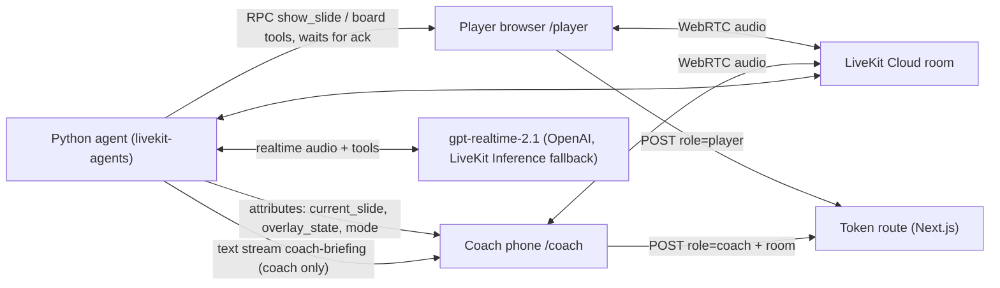

# Chalk Talk

Chalk Talk is a voice AI assistant coach named Floppy. It walks a Warriors player through a six-slide game plan for Game 7 of the 2016 NBA Finals. The slides follow your questions, and you can cut the coach off at any time. When you ask for the head coach, a real person joins the call from a phone, gets a private briefing, and takes over while the AI runs the slides.

**Status: work in progress.** This README only describes what is built and verified. Sections below are filled in as the work lands.

## What it does
- Presents a fixed six-slide Game 7 plan by voice. It opens on slide 1 only after the browser confirms the slide is on screen.
- Moves the deck from natural questions ("their best guy keeps getting downhill") to the right slide. The model picks from slide ids and topics defined in the deck data.
- Speaks only from the slide's points, notes and verified facts. Every number on screen traces to a row in `FACTS.md` with a source URL.
- Works the board with three bounded tools: `highlight` a player, zone or card (a highlighted Kyrie also lights the wing he attacks from); `run_play` animates one of four prepared plays while the agent talks through each caption; `add_callout` posts a sourced fact card or a short coaching note. The model chooses ids; it never writes layout or numbers.
- Refuses unsourced claims on screen: a free-text note with a digit, `%` or a spelled-out number is rejected in the agent and again in the browser.
- Stops at once when you talk over it (LiveKit Agents handles barge-in and history truncation).
- Hands off to a human: "Get me the head coach" shows a room-bound join link and QR. A coach on `/coach` gets a private briefing, the agent becomes a quiet clicker, and both screens stay on the same board. If the coach leaves, it returns to the player. Player, coach and any other human in the room appear on a camera rail to the right of the slide, so video never covers the board; the current speaker gets a gold border. The agent has no camera tile.

## Measured in development
| What | Result | Where |
|---|---|---|
| Slide RPC round trip, ack after paint | median 117 ms (103-122 ms, n=10, local agent to LiveKit Cloud) | `LEARNINGS.md` (spike 3) |
| Agent ear switch from player to coach | 0.66 ms for `set_participant`, 46 ms including clicker mode, no realtime session reset | `LEARNINGS.md` (spike 1) |
| Tool choice, text turns, 26 utterances x 3 runs | correct tool 96-100%; slide content spoken before the slide tool: 0 of 344 pre-tool lines | `DECISIONS.md` ADR-026 |

## Try it
_Live link and demo video: to be added._

## Run locally
Secrets live in `.env` (repo root) and `web/.env.local`. Copy them from the private machine env; never commit them.

```bash
cd agent && uv sync
cd web && pnpm install
make agent-dev      # cd agent && lk agent dev --deployment ${LIVEKIT_AGENT_DEPLOYMENT:-production}
make web-dev        # http://localhost:3000
make agent-test
make web-lint
make web-typecheck
```

Once a cloud agent exists (`lk agent create`), a local worker on production takes real traffic. Set `LIVEKIT_AGENT_DEPLOYMENT` then.

`AGENT_NAME` must match on the agent (`@server.rtc_session(agent_name=...)`) and in the player token's explicit dispatch. `POST /api/token` mints short-lived player and coach tokens with a `role` attribute. A missing `LIVEKIT_URL` fails loudly; there is no homepage-agent fallback. The realtime model uses `REALTIME_PROVIDERS=openai,inference` by default (OpenAI plugin first, LiveKit Inference fallback). Evals pin `REALTIME_PROVIDERS=openai`. `CHALK_DEBUG=1` skips realtime credential checks and the GPT session so the RPC probe can run without an OpenAI key.

## Architecture

- One LiveKit room per session. Participants are found by a `role` attribute set in the token, never by join order.
- Every slide and board change is an RPC to the player with an increasing `seq`. The agent narrates only after the ack. The browser drops stale `seq`.
- The agent mirrors the acked state into its own attributes, so the coach and any late joiner render the same board.
- Contracts: `docs/ARCHITECTURE.md`. Deck and facts: `deck/`, generated copies kept in sync by `scripts/sync_deck.py --check`.

## Why X, not Y (short)
| Choice | Over | Why | ADR |
|---|---|---|---|
| LiveKit room + server agent | Direct browser-to-Realtime | A real human must join the same call; tools and guardrails stay server-side | 001, 003 |
| GPT Realtime | STT-LLM-TTS pipeline | Natural voice, native tools; measured tool order was acceptable | 002, 026 |
| RPC with ack + `seq` | Fire-and-forget events | The agent never describes a slide that is not on screen | 006, 007 |
| Fixed deck + bounded board tools | Generated slides / generative UI | Every claim is checkable; the model picks approved content, it does not author it | 011, 015, 017 |
| OpenAI first, Inference fallback | Inference only | Free-tier credit cap would end the demo mid-session | 024 |

## Decisions
See `DECISIONS.md`.

## Known limits
- The coach link is a bearer link: anyone with it can join as coach. Rooms are random 64-bit ids with a short token TTL.
- No rate limit on the token route; rooms close when empty and hold at most four people.
- After handoff the agent hears one human at a time; a speaker change can clip the first words.
- If the briefing or the handoff line fails, the coach is ignored until they rejoin.
- The LiveKit Inference fallback is only as available as the free-tier Inference credit.
- The slide 6 joke image and the two team logos cannot be licensed, so they load only from a gitignored `local-assets/` folder. The public build shows a text-only card and drawn GSW/CLE badges.
- The player view is built for a laptop; on a phone in portrait it asks you to rotate.
- Camera permission is optional. If it is blocked, voice still works and the tile shows a role fallback.
- Play steps follow `lk.agent.state === speaking`. Captioned steps hold 4–10s of speech each and freeze if the model pauses. A clicker-silent play still finishes at deck speed after 700ms.
