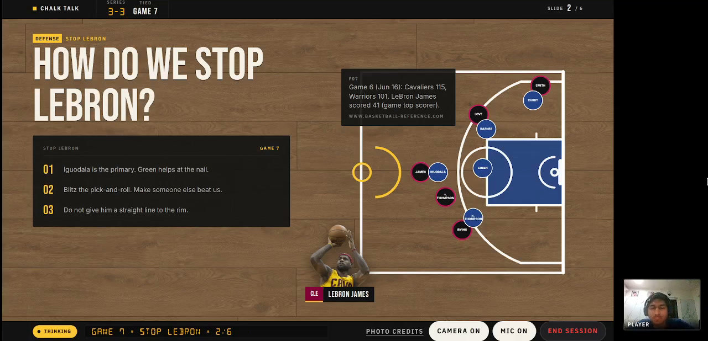
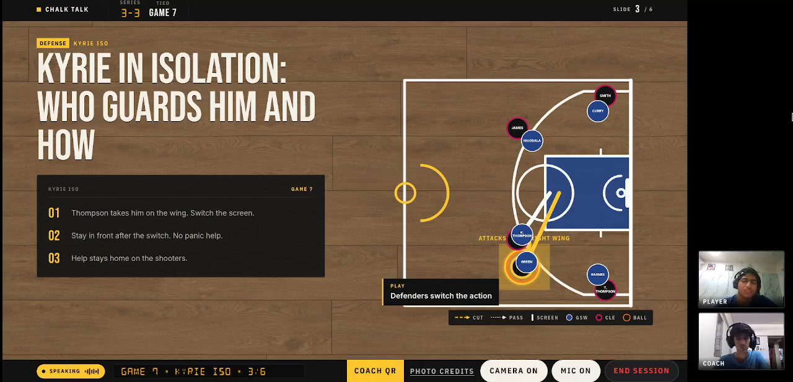
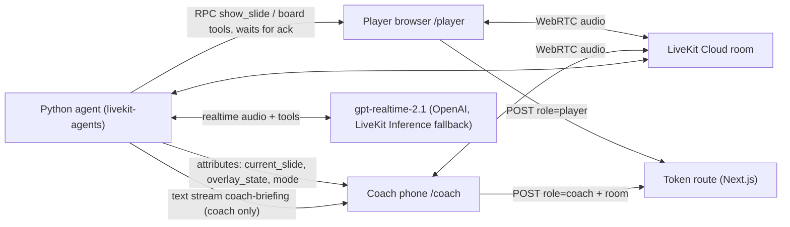

# Chalk Talk

Chalk Talk is a voice AI assistant coach named Floppy. It walks a Warriors player through a six-slide game plan for Game 7 of the 2016 NBA Finals. The slides follow your questions, and you can cut the coach off at any time. When you ask for the head coach, a real person joins the call from a phone, gets a private briefing, and takes over while the AI runs the slides.



**Demo video (4:00):** [youtu.be/3dlApJA9j4Y](https://youtu.be/3dlApJA9j4Y)

This README only describes what is built and verified.

## What it does
- Presents a fixed six-slide Game 7 plan by voice. The board stays blank through the opening line. Slide 1 loads when you ask for the plan, and only after the browser acks that slide.
- Moves the deck from natural questions ("their best guy keeps getting downhill") to the right slide. The model picks from slide ids and topics defined in the deck data.
- The presenter prompt tells it to speak from the slide tool result: points, notes and fact claims. Spoken wording is not checked in code. Every number rendered on a fact card comes from a verified row in `FACTS.md`.
- Works the board with three bounded tools: `highlight` a player, zone or card (highlighting Kyrie also lights `z_right_wing`, the attack zone stored for him on slide 3); `run_play` animates one of four prepared plays, and captioned steps advance while the agent is speaking; `add_callout` posts a sourced fact card or a short coaching note. The model chooses ids; it never writes layout or numbers.
- Rejects a free-text callout that has a digit, `%`, `#`, `$` or a spelled-out number, in the agent and again in the browser. A sentence with no number can still be posted. The prompt tells the model to refuse those.
- Stops at once when you talk over it (LiveKit Agents handles barge-in and history truncation).
- Hands off to a human: "Get me the head coach" shows a room-bound join link and QR. A coach on `/coach` gets a private briefing (text stream plus the `coach_briefing` attribute). The agent becomes a quiet clicker, and both screens stay on the same board. If the coach leaves, it returns to the player. Player, coach and any other human in the room appear on a camera rail to the right of the slide, so video never covers the board; the current speaker gets a gold border. The agent has no camera tile.



## Measured in development
| What | Result | Where |
|---|---|---|
| Slide RPC round trip, ack after paint | Recorded in the spike 3 note: median 117 ms (103-122 ms, n=10, local agent to LiveKit Cloud). Not re-run from this tree. | `LEARNINGS.md` |
| Agent ear switch from player to coach | Recorded in the spike 1 note: 0.66 ms for `set_participant`, 46 ms including clicker mode, no realtime session reset. Current leave and floor-router behavior is in the agent, not in that spike. | `LEARNINGS.md`, ADR-025, ADR-028 |
| Tool-choice harness | Not in this repo. There is no `evals/` directory and no script that prints a pass rate. ADR-026 records why Realtime stayed. | `DECISIONS.md` ADR-026 |

## Try it
[](https://youtu.be/3dlApJA9j4Y)

The video is one continuous session, trimmed at the ends with no cuts in between: the player asks questions, Floppy moves the deck and works the board, the head coach joins from a phone and drives the board by voice. There is no hosted deployment; to run it yourself, follow "Run locally" below with your own LiveKit Cloud and OpenAI keys.

## Run locally
Secrets live in `.env` (repo root) and `web/.env.local`. The agent loads `agent/.env.local` first, then the repo-root `.env` (the first file wins). Next.js reads `web/.env.local` only. Copy values from the private machine env; never commit them. The agent needs `NEXT_PUBLIC_APP_URL` in an env file it loads, because that is the origin of the coach join link.

```bash
cd agent && uv sync
cd web && pnpm install
make agent-dev      # cd agent && lk agent dev --deployment ${LIVEKIT_AGENT_DEPLOYMENT:-production}
make web-dev        # cd web && pnpm dev --hostname 0.0.0.0  (http://localhost:3000)
make agent-test
make web-lint
make web-typecheck
```

Once a cloud agent exists (`lk agent create`), a local worker on production takes real traffic. Set `LIVEKIT_AGENT_DEPLOYMENT` then.

`AGENT_NAME` must match on the agent (`@server.rtc_session(agent_name=...)`) and in the player token's explicit dispatch. `POST /api/token` mints 15-minute player and coach tokens with a `role` attribute. `GET /api/token` returns 405. A missing `LIVEKIT_URL` fails on `/player` at import and on the token route when it is called; there is no homepage-agent fallback. The realtime model uses `REALTIME_PROVIDERS=openai,inference` by default (OpenAI plugin first, LiveKit Inference fallback) and `REALTIME_MODEL=gpt-realtime-2.1` with voice `marin`. There is no eval harness to pin a provider. `CHALK_DEBUG=1` skips realtime credential checks and the GPT session so the RPC probe can run without an OpenAI key. `CHALK_SESSION_DEBUG=1` logs transcripts on a normal realtime session.

## Architecture

- One LiveKit room per session. Participants are found by a `role` attribute set in the token, never by join order.
- Every slide and board change is an RPC to the player with an increasing `seq`. The agent narrates only after the ack. The browser drops stale `seq`.
- The agent mirrors the acked state into its own attributes, so the coach and any late joiner render the same board.
- Contracts: `docs/ARCHITECTURE.md`. Deck and facts: `deck/`, generated copies kept in sync by `scripts/sync_deck.py --check`.

## Why X, not Y (short)
| Choice | Over | Why | ADR |
|---|---|---|---|
| LiveKit room + server agent | Direct browser-to-Realtime | A real human must join the same call; tools and guardrails stay server-side | 001, 003 |
| GPT Realtime | STT-LLM-TTS pipeline | Natural voice and native tools. No pipeline is configured. ADR-026 kept Realtime after a text spike whose harness is not in this repo | 002, 026 |
| RPC with ack + `seq` | Fire-and-forget events | The agent never describes a slide that is not on screen | 006, 007 |
| Fixed deck + bounded board tools | Generated slides / generative UI | Every claim is checkable; the model picks approved content, it does not author it | 011, 015, 017 |
| OpenAI plugin first, Inference fallback | Inference only | The session keeps a second realtime model if the OpenAI plugin fails. Inference still depends on that project's Inference quota | 024 |

## Decisions
See `DECISIONS.md`.

## Known limits
- The coach link is a bearer link: anyone with it can join as coach. Room names are `fr-` plus 16 hex characters. Tokens last 15 minutes.
- No rate limit on the token route. The player token sets `emptyTimeout` to 60 seconds, `departureTimeout` to 20 seconds, and `maxParticipants` to 4.
- After handoff the agent hears one human at a time. A 200 ms floor router can move that ear between the player and the coach. A speaker change can clip the first words.
- If storing and sending the briefing both fail, or the handoff line fails, that coach is not switched until they rejoin. A failed text stream still continues the switch when the `coach_briefing` attribute was stored.
- The LiveKit Inference fallback can only answer when that project's Inference quota accepts the session.
- The bottom rail shows Listening, Thinking, Speaking, or Waiting. It does not show turn latency, an interruption log, or a slide trace.
- Clicker mode stays quiet unless the model judges the turn to be addressed as Floppy or Assistant. There is no keyword gate on those names. `show_slide` still runs when the humans move to another slide topic, and `run_play` may run when they clearly discuss a prepared play.
- The slide 6 joke image and the two team logos cannot be licensed, so they load only from a gitignored `local-assets/` folder. When those files are absent, slide 6 shows a text-only card and slide 1 shows drawn GSW/CLE badges.
- The player view is built for a laptop. In portrait it says "Rotate your phone or open on a laptop." The coach page does not show that hint.
- Camera permission is optional. If it is blocked, voice still works and the tile shows a role fallback.
- Play steps follow `lk.agent.state === speaking`. Captioned steps hold 4–10s of speech each and freeze if the model pauses. A clicker-silent play still finishes at deck speed after 700ms.
