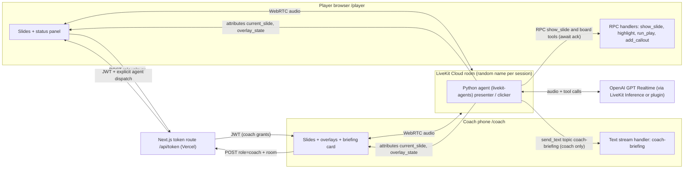
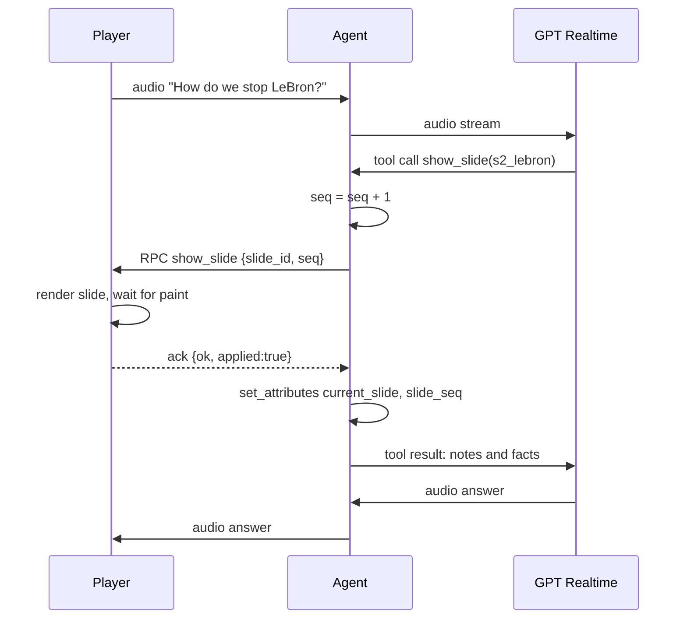
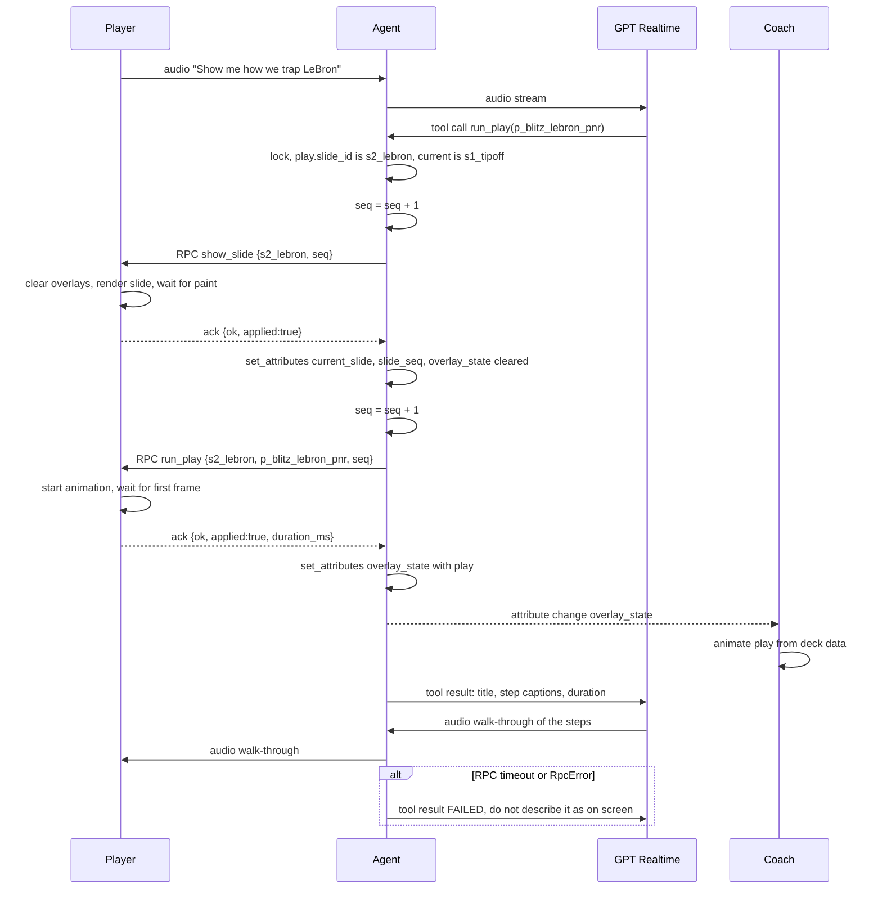
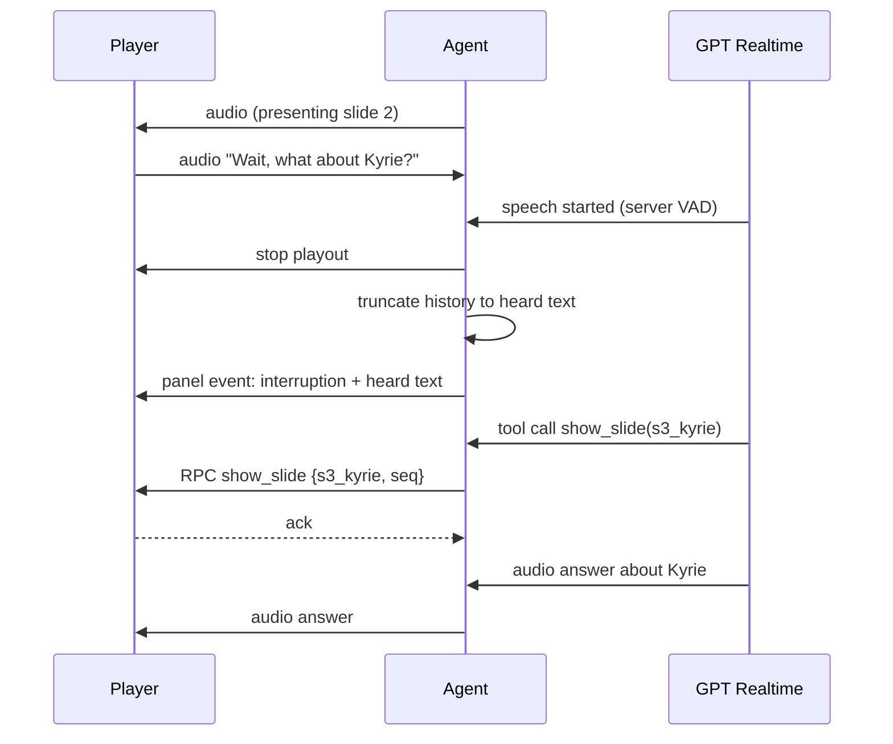
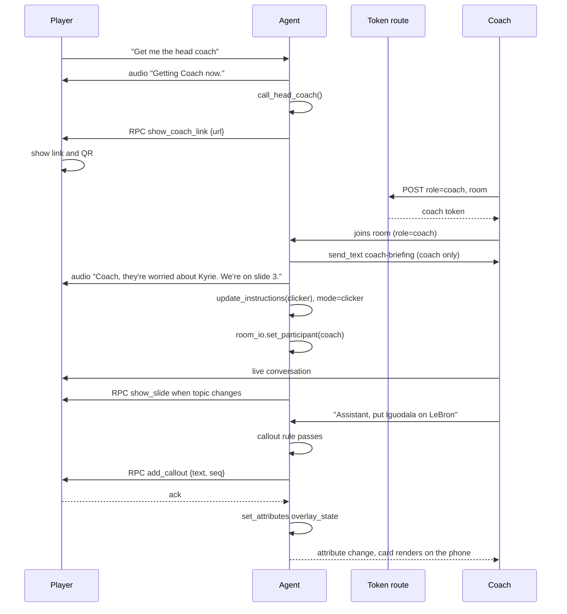

# Chalk Talk — architecture and contracts

Status: design. Items marked `[UNVERIFIED - check LiveKit docs]` must be confirmed with the LiveKit docs MCP before use. Items marked `[VERIFIED]` were checked with `lk docs` (search, get-page, code-search) against livekit-agents 1.8.8 docs; the source is named inline. Contracts here are the source of truth for both agent and web code. Change them only through the planner, and log the change in `DECISIONS.md`.

## System diagram


## Components
| Component | Tech | Responsibility |
|---|---|---|
| Agent | Python, `livekit-agents` 1.8.x, `AgentSession` + GPT Realtime | Presents, routes slides and board tools, validates tool input, owns seq and overlay state, generates briefing, switches modes |
| Deck data | One file in `agent/` (JSON or Python) | Single source of slide ids, titles, notes, fact ids, diagrams (markers, zones) and plays. Web imports or receives the same data. |
| Facts data | Generated from `FACTS.md` | Fact id, claim text, verified flag. Source for the `add_callout` fact enum and card text. |
| Token route | Next.js route handler, `livekit-server-sdk` | Mints role-scoped tokens, random room, explicit dispatch, short TTL |
| `/player` | Next.js page from `agent-starter-react` | Slides, overlays (RPC-driven), mic, status panel, coach link + QR |
| `/coach` | Next.js page | Slides, overlays (attribute-driven), mic, private briefing card |
| Eval | Python script in `evals/` | Utterances -> expected and forbidden tool calls (slides, board tools, handoff). Runs 3x. Prints pass rate per group. Item format: `docs/PRODUCT.md#eval`. |

Deck single source: the planner decides how web gets the deck (shared JSON file imported by both, or bundled copy generated from one file). It must not be hand-duplicated. The same holds for facts: `FACTS.md` is the source. A script or a test keeps the facts data in step with it.

## Contracts

### Participant identities and attributes
| Key | Set by | Values | Notes |
|---|---|---|---|
| `role` | Token route (token attributes) | `player` \| `coach` | The agent finds participants by this. Never by join order. `[VERIFIED]` `AccessToken` options take `attributes?: Record<string, string>` (`livekit-server-sdk` `AccessToken.ts`); docs: initial attribute values can be set in the token. Human tokens must NOT get `canUpdateOwnMetadata`, or a client could rewrite its own `role` (participant-attributes doc). |
| `current_slide` | Agent (`local_participant.set_attributes`) | slide id string, e.g. `s3_kyrie` | Late joiners and reconnects render from this. |
| `slide_seq` | Agent | integer as string | Seq of the last acked slide. |
| `overlay_state` | Agent | JSON string, see [Overlay state](#overlay-state) | Current board overlays. Set only after an ack. Cleared in the same `set_attributes` call that changes `current_slide`. |
| `mode` | Agent | `presenter` \| `clicker` | UI shows it in the status panel. |
| `lk.agent.state` | LiveKit (built in) | listening / thinking / speaking ... | Used for turn state in the panel. |

Identity format: `player-<random>`, `coach-<random>`. Identity prefix is not trusted for routing; the `role` attribute is.

### Slide ids (enum)
`s1_tipoff`, `s2_lebron`, `s3_kyrie`, `s4_offense`, `s5_xfactors`, `s6_last_two`

### Deck data additions
The deck data is the single source for board ids. Tool enums, browser validation and rendering all read it. Names, positions and steps below are placeholders that the planner checks (see `docs/PRODUCT.md#slides`).

Player ids (enum `PlayerId`):
| id | Label |
|---|---|
| `gsw_curry` | Curry |
| `gsw_thompson` | K. Thompson |
| `gsw_green` | Green |
| `gsw_iguodala` | Iguodala |
| `gsw_barnes` | Barnes |
| `cle_james` | James |
| `cle_irving` | Irving |
| `cle_love` | Love |
| `cle_smith` | Smith |
| `cle_tthompson` | T. Thompson |

Zone ids (enum `ZoneId`): `z_paint`, `z_top_key`, `z_left_wing`, `z_right_wing`, `z_left_corner`, `z_right_corner`, `z_left_elbow`, `z_right_elbow`, `z_high_post`.

Card ids (enum `CardId`): `k_jr_card`. A card is a pre-placed, hidden slide element. `highlight` on a card reveals it. Only `s6_last_two` has a card.

`TargetId` = `PlayerId` + `ZoneId` + `CardId`. `PlayId` = `p_blitz_lebron_pnr`, `p_switch_kyrie`, `p_steph_stagger`, `p_draymond_short_roll`.

Per slide:
| Slide | Diagram | Markers | Zones | Plays |
|---|---|---|---|---|
| `s1_tipoff` | none | — | — | — |
| `s2_lebron` | half court, GSW defending | all 10 | paint, top key, wings, corners | `p_blitz_lebron_pnr` |
| `s3_kyrie` | half court, GSW defending | all 10 | top key, wings, elbows, paint | `p_switch_kyrie` |
| `s4_offense` | half court, GSW on offense | all 10 | top key, wings, corners, high post, paint | `p_steph_stagger`, `p_draymond_short_roll` |
| `s5_xfactors` | text strip, no court | — | — | — |
| `s6_last_two` | blank half court | — (card: `k_jr_card`) | all zones | — |

Shape (sketch; planner fixes the final format):
```json
{
  "slides": [{
    "id": "s2_lebron",
    "diagram": {
      "kind": "half_court",
      "markers": {"cle_james": [50, 72], "gsw_iguodala": [50, 66]},
      "zones": ["z_paint", "z_top_key", "z_left_wing", "z_right_wing", "z_left_corner", "z_right_corner"]
    }
  }],
  "zones": {"z_paint": {"label": "Paint", "shape": "rect", "box": [34, 0, 66, 38]}},
  "plays": [{
    "id": "p_blitz_lebron_pnr",
    "slide_id": "s2_lebron",
    "title": "Blitz the LeBron pick-and-roll",
    "steps": [
      {"caption": "Screen comes at the top", "duration_ms": 1200, "ball": "cle_james",
       "moves": {"cle_tthompson": [56, 70]},
       "arrows": [{"from": "cle_tthompson", "to": [56, 70], "kind": "screen"}]},
      {"caption": "Two defenders jump the ball", "duration_ms": 1200,
       "moves": {"gsw_green": [54, 74], "gsw_iguodala": [46, 74]}, "arrows": []}
    ]
  }]
}
```
Formations (ADR-023):
- `diagram.matchups` (slides with markers): map of each defender id to the player he guards, for all five defenders.
- `play.start` (optional): marker positions and `ball` holder at the start of the play. Markers not listed keep the slide position. When a play runs, markers first move to `start` in one short step that has no caption. Two plays on one slide can then start from different formations.

Basketball sanity rules (planner check; the rim is at about [50, 5]):
- At slide start and play start, each defender is closer to the rim than the player he guards.
- A player who sets a screen in a step does not hold the ball in that step.
- `ball` changes only through a `pass` arrow from the previous holder in that step.
- In a trap step, both trapping defenders end within 8 units of the ball handler.

Rules for the deck schema test:
- Coordinates are half-court percent: x 0-100 left to right, y 0 at the baseline to 100 at half court.
- Every marker in a play's `moves`, `arrows` and `ball` exists on the play's slide.
- `arrows[].kind` is one of `cut`, `dribble`, `pass`, `screen`, `rotate`.
- 2-5 steps per play. `duration_ms` is an integer in 300-3000.
- Captions: at most 40 characters, and they pass the callout text rule (no numbers).
- Every slide's zones exist in `zones`. Every `TargetId` and `PlayId` is unique.
- Deck `fact_ids` and the `add_callout` enum contain only `FACTS.md` rows with verified = y.

### Agent tools
```text
show_slide(slide_id: enum above) -> str
  - agent increments its own seq (the model does not pick seq)
  - perform_rpc to the player identity, method "show_slide", response_timeout ~3s
  - on ack: set attributes current_slide + slide_seq + cleared overlay_state in one call,
    return slide title + notes + facts + the slide's board menu (targets, plays) for narration
  - on timeout / RpcError: return "FAILED: slide not shown (<reason>). Do not describe it as on screen."

call_head_coach() -> str
  - agent builds coach join URL: <app>/coach?room=<room_name>
  - sends link to player (RPC "show_coach_link") so the player UI shows link + QR
  - records handoff_requested in the timeline
  - returns "Coach link is on screen. Say one short line, then wait."

highlight(target: TargetId) -> str
  - TargetId = enum of every player id, zone id and card id in the deck data
  - a card target (k_jr_card) reveals the hidden card instead of a highlighter swipe;
    it counts toward the 2-highlight limit like any target
  - agent checks target is on the current slide's diagram; if not, returns
    "FAILED: <target> is not on this slide. Targets here: <list>. Call show_slide first if needed."
    (no RPC sent)
  - seq = seq + 1, perform_rpc "highlight" to player, response_timeout ~3s
  - on ack: update overlay_state, return "Highlighted <label>. Refer to it as highlighted."
  - on timeout / RpcError: return "FAILED: highlight not shown (<reason>). Do not say it is highlighted."

run_play(play_id: PlayId) -> str
  - PlayId = enum of play ids in the deck data
  - if play.slide_id != current slide: run the show_slide path first (own seq, own ack).
    If that fails, return its failure string. Do not send run_play.
  - seq = seq + 1, perform_rpc "run_play" to player, response_timeout ~3s
  - player acks when the first frame of the play is painted (animation started)
  - on ack: update overlay_state, return play title + step captions in order + total duration,
    "The play is running on screen. Walk through the steps in order, briefly."
  - on timeout / RpcError: return "FAILED: play not shown (<reason>). Do not describe it as on screen."

add_callout(fact_id: FactId | None = None, text: str | None = None) -> str
  - FactId = enum of FACTS.md ids with verified = y only
  - exactly one of fact_id or text; agent validates with the callout rule below before any RPC
  - on rule failure: return "FAILED: callout rejected (<rule>). Use a fact_id for any stat, or reword as a short instruction with no numbers." (no RPC sent)
  - seq = seq + 1, perform_rpc "add_callout" to player, response_timeout ~3s
  - on ack: update overlay_state, return "Callout is on both screens."
  - on timeout / RpcError: return "FAILED: callout not shown (<reason>)."
```
Note: the user brief says `show_slide(slide_id, seq)`. Seq is owned by the agent code, not the model, so the model cannot send a stale or wrong seq. Planner may revisit.

Board tools are a fixed menu. The model only picks enum ids (and short instruction text for callouts). It never sends coordinates, layout, colors or markup. There is no clear tool: overlays clear on slide change, and limits drop the oldest item.

Tool execution order: every tool that sends an RPC runs under one agent-side `asyncio.Lock`, in call order. A `highlight` that follows a `show_slide` in the same model response is checked against the slide after that `show_slide` acked. Whether `livekit-agents` runs parallel function calls concurrently: not stated in the docs (`function_tools_executed` reports a batch; execution order not documented). Treated as possibly concurrent. The lock makes this safe either way. Spike 2 logs the observed order.

Seq: one agent-owned counter for all agent -> player commands (`show_slide`, `highlight`, `run_play`, `add_callout`). The browser keeps one `last_applied_seq`. See ADR-016.

### Tools by mode
| Tool | Presenter | Clicker |
|---|---|---|
| `show_slide` | Before speaking about any slide | When the humans move to a topic on another slide |
| `highlight` | When pointing at a player or zone answers the question, or when asked | Only when a human addresses the agent |
| `run_play` | When asked to show or walk through a play, or when the play is the clearest answer | When addressed, or when the humans clearly discuss one of the plays |
| `add_callout` | Only when a human asks to put something up | Only when a human addresses the agent |
| `call_head_coach` | On request; offered for slide 6 topics | Not used |

In clicker mode the agent stays silent after a board change unless addressed; if addressed, one short line at most. If Spike 1 shows the agent hears only the coach after handoff, player-addressed triggers in clicker mode do not apply.

### RPC methods (agent -> browser)
All payloads are JSON strings. Handlers registered in `useEffect`, unregistered in cleanup.

`show_slide` (destination: player identity)
```json
{
  "type": "object",
  "required": ["slide_id", "seq"],
  "additionalProperties": false,
  "properties": {
    "slide_id": {"enum": ["s1_tipoff","s2_lebron","s3_kyrie","s4_offense","s5_xfactors","s6_last_two"]},
    "seq": {"type": "integer", "minimum": 1}
  }
}
```
Ack (returned string, JSON):
```json
{"ok": true, "slide_id": "s3_kyrie", "seq": 7, "applied": true}
```
If `seq` <= last applied seq: return `{"ok": true, "slide_id": "...", "seq": 7, "applied": false, "reason": "stale"}`. Do not render.
On an applied slide change the browser clears all overlays (highlights, play, callouts) before it renders the new slide. The old `highlight` field on this payload is removed; highlights use the `highlight` method.

`show_coach_link` (destination: player identity)
```json
{"type":"object","required":["url"],"properties":{"url":{"type":"string"}}}
```
Ack: `{"ok": true}`

Board methods (destination: player identity). Common rules:
- `slide_id` is the slide the agent believes is on screen. If it differs from the browser's current slide, throw `RpcError` 2007.
- Stale `seq` (<= last applied seq): ack `{"ok": true, "seq": N, "applied": false, "reason": "stale"}` and do not render.
- The browser validates ids against the same deck data and throws `RpcError` on bad input.
- Ack after the change is painted (same method as `show_slide`).

#### highlight
```json
{
  "type": "object",
  "required": ["slide_id", "seq", "target"],
  "additionalProperties": false,
  "properties": {
    "slide_id": {"enum": ["s2_lebron","s3_kyrie","s4_offense","s6_last_two"]},
    "seq": {"type": "integer", "minimum": 1},
    "target": {"type": "string", "description": "player id, zone id or card id present on slide_id"}
  }
}
```
Ack: `{"ok": true, "seq": 9, "applied": true, "target": "cle_irving", "active": ["cle_irving"]}`. `active` lists highlights now on screen (max 2; the oldest drops). A revealed card is in `active`; if it drops, it hides again. For `k_jr_card` the browser acks after the card is painted, whether it shows the local image or the text-only fallback (image file missing). The ack may add `"fallback": true`.

#### run_play
```json
{
  "type": "object",
  "required": ["slide_id", "seq", "play_id"],
  "additionalProperties": false,
  "properties": {
    "slide_id": {"enum": ["s2_lebron","s3_kyrie","s4_offense"]},
    "seq": {"type": "integer", "minimum": 1},
    "play_id": {"enum": ["p_blitz_lebron_pnr","p_switch_kyrie","p_steph_stagger","p_draymond_short_roll"]}
  }
}
```
Ack (sent when the first frame is painted, not at the end): `{"ok": true, "seq": 11, "applied": true, "play_id": "p_blitz_lebron_pnr", "duration_ms": 4800}`. `duration_ms` is the sum of the play's step durations from deck data (the value here is an example). The last frame stays on screen. A new `run_play` replaces the current play. Highlights stay; a highlighted marker ring follows the marker.

#### add_callout
```json
{
  "type": "object",
  "required": ["slide_id", "seq", "callout_id"],
  "additionalProperties": false,
  "oneOf": [{"required": ["fact_id"]}, {"required": ["text"]}],
  "properties": {
    "slide_id": {"enum": ["s1_tipoff","s2_lebron","s3_kyrie","s4_offense","s5_xfactors","s6_last_two"]},
    "seq": {"type": "integer", "minimum": 1},
    "callout_id": {"type": "string", "description": "agent-assigned, e.g. c4"},
    "fact_id": {"type": "string", "pattern": "^F[0-9]{2}$"},
    "text": {"type": "string", "minLength": 3, "maxLength": 60}
  }
}
```
Ack: `{"ok": true, "seq": 14, "applied": true, "callout_id": "c4", "active": ["c3", "c4"]}`. Max 3 callouts; the oldest drops.

Card rendering: a fact callout shows the `FACTS.md` claim text verbatim, a fact id badge and the source domain. A text callout is labelled "Coach's note". The two styles must look different.

#### Callout rule
Applied in the agent before the RPC and again in the browser (defense in depth). Same function spec, unit-tested on both sides.
1. Exactly one of `fact_id` or `text`.
2. `fact_id` must be a `FACTS.md` row with verified = y. Unverified ids are not in the tool enum. The model's own wording is never shown with a fact card.
3. `text` is for short coaching instructions only (who guards whom, what to do). After trimming: 3-60 characters, at most 8 words, one line.
4. `text` has no digits (0-9) and none of `%`, `#`, `$`.
5. `text` has no spelled-out numbers, whole word, case-insensitive: two through twenty, thirty, forty, fifty, sixty, seventy, eighty, ninety, hundred, thousand, million, dozen, percent. "one" is allowed so "one-on-one" passes.
6. Any stat or factual claim must go through `fact_id`. Rules 3-5 are the hard floor in code. The prompt and the eval negatives cover claims without numbers ("he shot badly last game"): the agent must refuse those as text.

Errors: throw `RpcError` (never return an "Error:" string).
| Code | Meaning |
|---|---|
| 2001 | unknown slide_id |
| 2002 | malformed payload (bad JSON or schema) |
| 2003 | not ready (deck not mounted) |
| 2004 | unknown target, or target not on this slide |
| 2005 | callout rejected by the callout rule |
| 2006 | unknown play_id, or play does not belong to slide_id |
| 2007 | slide mismatch (payload slide_id is not the slide on screen) |

`[VERIFIED]` (RPC doc, "Errors"): codes 1001-1999 are reserved for LiveKit. App codes therefore use 2001-2007 (ADR-020). Built-in codes the agent must map to a failure string: 1400 unsupported method, 1401 recipient not found, 1500 application error (any non-`RpcError` throw), 1501 connection timeout, 1502 response timeout, 1503 recipient disconnected, 1505 send failed. Default `response_timeout` is 10 s; we set about 3 s.

Ack timing: the browser acks after the slide is committed to the screen (after next paint). Planner decides the exact method (e.g. `requestAnimationFrame`) in the RPC spike. Board methods use the same method; `run_play` acks after the first animation frame.

### Overlay state
Choice (ADR-016): the player gets board changes as acked RPC. The agent then mirrors the result into its own participant attribute `overlay_state`. The coach page and any late joiner render from that attribute. The coach does not get RPC.

Rules:
- The agent is the only writer. It writes `overlay_state` only after an ack with `applied: true`.
- On an applied `show_slide`, the agent sets `current_slide`, `slide_seq` and a cleared `overlay_state` in one `set_attributes` call. Whether one call is delivered as one atomic update: not stated in the docs (they say each key updates without sending the others). The browser renders overlays only when `overlay_state.slide_id` equals `current_slide`, so a split update is harmless.
- The value stores ids only, no geometry. Both pages look up geometry, captions and fact text in the deck and facts data.
- Attribute size limits: `[VERIFIED]` 64 KiB combined across all keys and values (participant-attributes doc, "Size limits"). The agent has the right to set its own attributes. The capped value (2 highlights, 1 play, 3 callouts of at most 60 characters) is well under 1 KB.

Schema:
```json
{
  "type": "object",
  "required": ["v", "slide_id", "seq", "highlights", "play", "callouts"],
  "additionalProperties": false,
  "properties": {
    "v": {"const": 1},
    "slide_id": {"type": "string"},
    "seq": {"type": "integer", "description": "seq of the last applied command"},
    "highlights": {"type": "array", "maxItems": 2, "items": {"type": "string"}},
    "play": {
      "oneOf": [
        {"type": "null"},
        {"type": "object", "required": ["play_id", "seq"], "properties": {"play_id": {"type": "string"}, "seq": {"type": "integer"}}}
      ]
    },
    "callouts": {
      "type": "array", "maxItems": 3,
      "items": {"type": "object", "required": ["callout_id"], "properties": {
        "callout_id": {"type": "string"}, "fact_id": {"type": "string"}, "text": {"type": "string"}}}
    }
  }
}
```
Example:
```json
{"v":1,"slide_id":"s2_lebron","seq":15,"highlights":[],"play":{"play_id":"p_blitz_lebron_pnr","seq":12},"callouts":[{"callout_id":"c4","text":"Iguodala on LeBron"}]}
```

Rendering from the attribute (coach page, and player page on reconnect):
- On first read after connect: render the end state. A play shows its last frame; it does not replay.
- On a later change: animate what is new. A play animates once per `play.seq`.
- The coach's animation is not frame-synced with the player's. It starts when the attribute arrives. This is accepted (ADR-016).

### Text streams
| Topic | Direction | Destination | Content |
|---|---|---|---|
| `coach-briefing` | agent -> coach | `destination_identities=[coach_identity]` only | JSON: `{"asked": [...], "main_worry": "...", "current_slide": "s3_kyrie", "summary": "..."}` |
| `lk.transcription` | built in | all | Live transcripts for the panel |
| `chalk-talk-events` (optional) | agent -> player | player | Panel events: slide trace, interruption, handoff timeline. Planner may use attributes instead. |

`send_text(..., topic=..., destination_identities=[...])` is documented for text streams. `[VERIFIED]` Python: `await room.local_participant.send_text(text, *, topic=..., destination_identities=[...])` is keyword-only (`livekit-rtc` `participant.py`). Executor confirms the exact keyword list in the installed version.

### Agent modes and the switch
| Mode | Instructions (substance) | Listens to |
|---|---|---|
| `presenter` | Present the deck. Call `show_slide` before speaking about any slide. Call a board tool before describing the board change. Answer from slide notes and facts only. Offer the head coach for slide 6 topics. Only the prepared plays exist; never invent one. | Player |
| `clicker` | Do not present. Do not answer unless addressed as "Assistant". Call `show_slide` when the humans move to a topic on another slide. Board tools when addressed; `run_play` also when the humans clearly discuss a prepared play. Stay silent otherwise. | Coach (and player if supported) |

The board tool rules come from [Tools by mode](#tools-by-mode). The prompt lists the menu by reading the deck data, not by a hand-written copy.

Exact switch trigger: the agent sees a participant join with `role=coach` (event `participant_connected`, or attribute change) AND a handoff was requested. Then, in order:
1. Build the briefing from the session so far.
2. `send_text` the briefing to the coach only.
3. Say the one handoff line ("Coach, they're worried about Kyrie. We're on slide 3.").
4. Update instructions to clicker mode (`agent.update_instructions(...)`). Set attribute `mode=clicker`.
5. Switch audio input to the coach: `session.room_io.set_participant(coach_identity)`. This method is documented (sessions doc, turns doc, `toggle_io.py` example). `[VERIFIED]` signature: `RoomIO.set_participant(participant_identity: str | None)`, "Switch audio and video streams to specified participant" (`room_io.py`). It takes one identity, so the agent hears one human at a time. Behavior mid-session with GPT Realtime: `[UNVERIFIED - Spike 1]`.

If a coach joins without a handoff request: still brief and switch (the link only exists after the request, so this is unlikely).

### Token route
`POST /api/token`

Request:
```json
{"role": "player"}
{"role": "coach", "room": "fr-8f3k2q"}
```
Response:
```json
{"serverUrl": "wss://...", "roomName": "fr-8f3k2q", "participantToken": "<jwt>", "participantName": "Player"}
```
Rules:
- `player`: server creates a random room name. Token includes explicit agent dispatch (`RoomConfiguration` with `agents: [{agentName}]`). TTL short (about 15 min).
- `coach`: must pass an existing room name. No dispatch. Short TTL.
- Grants (both): `roomJoin`, `room=<name>`, `canPublish` (audio), `canSubscribe`, `canPublishData` (needed for RPC responses). No `roomAdmin`, no `roomCreate`, no `roomList`.
- Sets token attribute `role`.
- Rejects unknown roles with 400. No GET route.
- The starter's production guard (throws unless `IS_VERCEL_PREVIEW=true`) must be handled deliberately, not deleted blindly. Planner decides.

Coach link risk: anyone with the link can join as coach. Acceptable for a demo; noted in README known limits.

## Sequence: slide change


## Sequence: run_play
The play's slide is not on screen yet, so the agent runs the slide path first.


## Sequence: interruption

Truncation is done by LiveKit Agents and the OpenAI plugin. Verify in logs, do not hand-roll. Heard text for the panel: `conversation_item_added` gives each committed `ChatMessage`; the message has an `interrupted` flag (`chat_context.py`), and after truncation its text is what was played. `[UNVERIFIED - Spike 2]` that the realtime path fills the truncated text; verify in logs.

## Sequence: handoff


## Late join and reconnect
- On connect, `/player` and `/coach` read the agent's `current_slide` and `overlay_state` attributes and render them. Plays show their last frame.
- Any RPC with a seq at or below the last applied seq is ignored. On reconnect, the player page sets its last applied seq from `overlay_state.seq` (or `slide_seq` if higher).

## Observability for the panel
- Turn state from `lk.agent.state`.
- Latency per turn: `[VERIFIED]` livekit-agents 1.8.7 adds realtime `e2e_latency` (last user speech to first agent playback) in `event.item.metrics` on `conversation_item_added` for assistant messages, when local VAD is configured (changelog 1.8.7). Show "—" when absent.
- Slide trace, board trace (tool, ids, ack or failure reason, round trip) and handoff timeline from agent-sent events.
